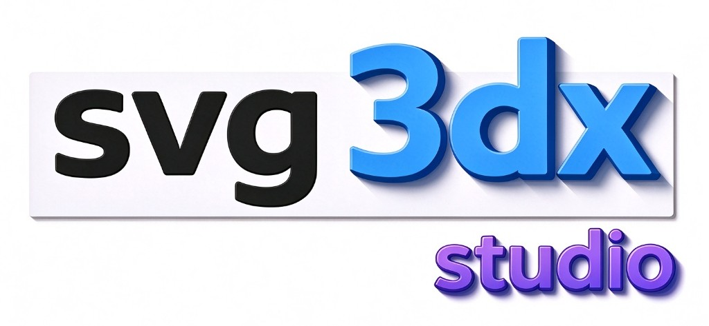

<p align="center">
  
</p>

# svg3dx-studio

[English](README.md) | 中文

**svg3dx Studio**：可嵌入的 Vue 页面库（浏览 / 编辑）+ 本仓演示 SPA。Vite + Vue 3 + TDesign + three.js。

渲染与参数面板复用 [svg3dx-viewer](https://github.com/xiaohunqupo/svg3dx-viewer)。

| 层 | 用途 |
|----|------|
| `ViewerHost` + `svg3dx-viewer` | 浏览预览（无点击选中） |
| `InteractHost` + `createInteract` | 编辑视口：拾取 / 高亮 / 变换 |
| `BrowsePage` / `EditPage` | 整页模板（插槽可改布局） |
| `DocumentRepository` / `AssetRepository` | 可替换的文档与 sidecar 存储 |

## 关联库

| 仓库 | 职责 |
|------|------|
| [svg3dx](https://github.com/xiaohunqupo/svg3dx) | 格式规范与 samples |
| [svg3dx-core](https://github.com/xiaohunqupo/svg3dx-core) | 解析求值引擎 |
| [svg3dx-viewer](https://github.com/xiaohunqupo/svg3dx-viewer) | 查看器组件 |
| **svg3dx-studio**（本仓） | 编辑器页面库 + 演示应用 |

## 嵌入（厂商宿主）

```bash
npm run build:lib   # → dist-lib/
# 或依赖 file:../svg3dx-studio（开发时可用 Vite alias 指到 src/lib/index.ts）
```

```ts
import { createApp } from "vue";
import { createPinia } from "pinia";
import TDesign from "tdesign-vue-next";
import "tdesign-vue-next/es/style/index.css";
import {
  installStudio,
  BrowsePage,
  EditPage,
  createIndexedDbDocumentRepository,
  createIndexedDbAssetRepository,
} from "svg3dx-studio";
import "svg3dx-studio/style.css";

const app = createApp(HostRoot);
const pinia = createPinia();
app.use(pinia);
app.use(router);
installStudio(app, {
  // 省略则默认 IndexedDB；接业务库 / FTP 代理时实现接口即可
  documents: createIndexedDbDocumentRepository(),
  assets: createIndexedDbAssetRepository(),
  navigation: {
    goBrowse: () => router.push("/studio"),
    goEdit: (id) => router.push(`/studio/edit/${id}`),
  },
  // AI 工具/界面默认开启。仅当宿主自带助手时关闭：
  // showAiAssistant: false,
});
app.use(TDesign);
```

路由挂载 `BrowsePage` / `EditPage`（`EditPage` 需 `props: true` 传入 `id`）。

### AI 助手

Studio 内置基于 CopilotKit 的助手，属于页面库的一部分。**默认开启**（`showAiAssistant: true`）。

- **演示 / 常规宿主**：根上挂 `<AiChatPanel />`，引入 `@copilotkit/vue/styles.css`，并运行/代理 Copilot Runtime（`npm run copilot` / `/api/copilotkit`）。
- **宿主自带 AI**：`installStudio(app, { showAiAssistant: false })`，且不要挂载 `AiChatPanel`（全局总开关）。
- **仅关某页 chrome**：`:show-ai-assistant="false"`（不会卸载根上已挂的 `AiChatPanel`）。

### 三层开放度

1. **整页**：直接挂页面；用 props（如 `showOfficialSamples`、`showAiAssistant`）与插槽微调。
2. **换存储**：实现 `DocumentRepository` / `AssetRepository`（list/get/save/remove；资产 list/read/write/removeAll）。
3. **自组布局**：只引 `ViewerHost` / `InteractHost` / `FileListPanel` / 节点面板等积木。

**Browse 插槽**：`topbar-start` · `topbar-end` · `sidebar` · `empty` · `viewport-chrome`  
**Edit 插槽**：`topbar-start` · `topbar-end` · `toolbar-extra` · `tree` · `source` · `viewport-chrome` · `inspector`

### 样式

- `import "svg3dx-studio/style.css"`
- 覆盖布局变量：`--svg3dx-studio-topbar-height`、`--svg3dx-studio-sidebar-width` 等（见 `src/styles/global.css`）
- 颜色沿用 TDesign `--td-*` / `theme-mode`

## 开发

本机并列：`svg3dx`、`svg3dx-core`、`svg3dx-viewer`、本仓。

```powershell
cd ..\svg3dx-studio
npm run build:all          # wasm → viewer → SPA dist + dist-lib
npm run build:all:dev      # 只到 viewer，随后 npm run dev
npm run build:lib          # 仅页面库
```

## CI / GitHub Pages

1. 检出 `svg3dx-core`、`svg3dx-viewer`、`svg3dx`
2. `wasm-pack` → core `pkg/`
3. `npm run build`（SPA，`VITE_BASE=/svg3dx-studio/`）→ Pages
4. `npm run build:lib` → 上传 `svg3dx-studio-lib` artifact

在线演示：https://xiaohunqupo.github.io/svg3dx-studio/

## 演示 SPA 路由

- `/` 浏览（默认 IndexedDB）
- `/edit/:id` 编辑

## 许可证

MIT OR MulanPSL-2.0。
